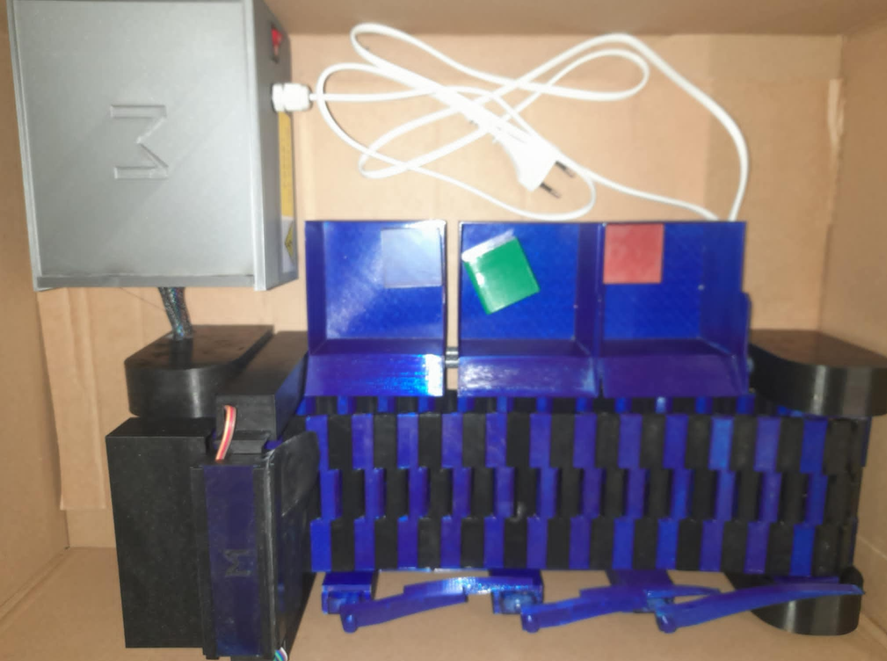

# Modular Mini Conveyor Belt for Arduino Automation



A small, fully 3D-printed conveyor belt for automation experiments on the desk. A TT gear motor drives the belt through an L9110S motor driver, an Arduino Nano runs it, and an IR obstacle sensor at the end of the belt starts, stops and counts parts. The frame is modular: print more frame sections to make the belt longer, bolt an SG90 pusher or a colour-sorting station beside it. This is a refurbished remix of [Modular Conveyor Belt for Educational Automation Projects](https://www.printables.com/model/1563833-modular-conveyor-belt-for-educational-automation-p) by wolfelm (Printables, CC BY-SA 4.0).

## Install and build guide

Remix of the Modular Conveyor Belt for Educational Automation Projects by wolfelm (Printables, CC BY-SA 4.0). This guide is written from scratch for an Arduino Nano + L9110S build. Read the whole guide once before printing.

### 1. Software first

1. Install the Arduino IDE (2.x) from arduino.cc. Under Boards select **Arduino Nano**; for CH340 clones select processor **ATmega328P (Old Bootloader)** if uploads fail.
2. No libraries are needed for the basic belt. The SG90 pusher uses the built-in `Servo` library.
3. Example sketch (MIT, Hawkridge). It runs the belt, stops when the IR sensor sees a part, counts it on the serial monitor and restarts after a short pause. Pins: L9110S `A-IA` on D5, `A-IB` on D6 (both PWM), IR sensor OUT on D2, optional limit switch on D3, optional servo on D9.

```cpp
#include <Servo.h>
const int MOTOR_A = 5, MOTOR_B = 6, IR_PIN = 2, LIMIT_PIN = 3, SERVO_PIN = 9;
const int SPEED = 180;            // 0-255 PWM, start around 150-200
Servo pusher; long count = 0;
void belt(int pwm){ analogWrite(MOTOR_A, pwm); analogWrite(MOTOR_B, 0); }
void setup(){
  pinMode(IR_PIN, INPUT); pinMode(LIMIT_PIN, INPUT_PULLUP);
  pusher.attach(SERVO_PIN); pusher.write(0);
  Serial.begin(115200); belt(SPEED);
}
void loop(){
  if (digitalRead(IR_PIN) == LOW) {          // most IR modules pull OUT low on detection
    belt(0); count++;
    Serial.print("part "); Serial.println(count);
    pusher.write(90); delay(400); pusher.write(0); delay(400);
    while (digitalRead(IR_PIN) == LOW) delay(10);   // wait until the part has cleared
    delay(150);                                       // debounce
    belt(SPEED);
  }
}
```

4. Upload with the motor driver unpowered first; open the serial monitor at 115200 and wave a hand in front of the IR sensor to see the counter work.

### 2. Printing the parts

The 25 STL files are in [`source/upstream/`](source/upstream/), unchanged from the original design. The upstream author did not publish a print-quantity table; the file names are Czech abbreviations, so print one of each first, then print extra belt links and frame sections as needed. Our reading of the set (confirm on your slicer plate):

- `HR1.stl`, `HRM1.stl`: main frame halves (one of each; `HRM1` is the motor-side frame).
- `R1.stl`, `R2.stl`, `L1.stl`, `L2.stl`: right and left side rails and guides.
- `ZSB1.stl`, `NZSB1.stl`, `SB1.stl`, `ZS1.stl`: roller and roller-housing parts (the `N` variant is the non-driven end).
- `Cp1.stl`, `C1.stl`: belt carrier/belt link parts; `Cp1` is the belt segment, print as many as the belt length needs.
- `P1.stl`, `OT1.stl`: motor plate and tensioner.
- `K1.stl`, `Ko1.stl`, `Z1.stl`, `Z2.stl`, `S1.stl`, `S2.stl`: small caps, wedges, spacers and sensor brackets.
- `díl1.stl` to `Díl 5.stl`: additional modular pieces ("díl" means "part").

Settings: PLA for everything rigid, 0.2 mm layers, 3 walls, 20 to 30 % infill, no supports unless your slicer flags overhangs. Print belt segments in TPU 95A at 20 to 30 mm/s with 100 % infill. `díl 2.stl` is a tiny 12-triangle part (a spacer); check its size before printing.

### 3. Mechanical assembly

1. Join the two frame halves and the side rails with M3 x 10 screws and nuts. Keep the screws loose until the rollers are in.
2. Press the roller parts together on the driven and the idle end. The driven roller has the D-shaped bore for the TT motor shaft.
3. Fit the TT motor to the motor plate (`P1`) with the two M3 x 16 screws through the motor ears, then bolt the plate to the motor-side frame (`HRM1`).
4. Link the belt segments into a loop around both rollers. Count the segments so the loop is snug but can still be stretched by hand over the last roller.
5. Fit the tensioner (`OT1`) and tighten the frame screws evenly. The belt should run centred; if it walks to one side, back off the tensioner on that side a quarter turn.
6. Mount the IR sensor bracket at the discharge end, facing across the belt, and the optional SG90 pusher bracket beside the belt.

### 4. Wiring

- 5 V supply to the barrel-jack adapter, then to the breadboard rails. L9110S `VCC` to +5 V, `GND` to ground. Connect the Nano `GND` to the same ground; power the Nano from USB during testing.
- Motor to L9110S `MOTOR A` terminals. `A-IA` to D5, `A-IB` to D6.
- IR sensor: `VCC` 5 V, `GND`, `OUT` to D2.
- Limit switch (optional): common to D3, normally-open to ground (the sketch uses `INPUT_PULLUP`).
- SG90 (optional): brown to ground, red to +5 V from the supply (not the Nano 5 V pin), orange to D9.

### 5. Calibration and first run

1. Power the 5 V supply, then plug in the Nano. The belt should run immediately. If it runs backwards, swap the two motor wires.
2. Turn the IR sensor potentiometer until the LED only lights with a part on the belt in front of it.
3. Lower `SPEED` if the belt skips; raise it if a loaded belt stalls. TT motors with the 1:90 gearbox give a slow, strong belt.
4. Place parts on the belt and watch the counter in the serial monitor.

### 6. Troubleshooting

- Belt stalls at the roller: tensioner too tight, or a belt segment printed too stiff; loosen or reprint that segment in TPU.
- Counter counts twice per part: increase the debounce delay or move the sensor so the part passes it faster.
- Motor hums but does not turn: check that both PWM pins are not high at once, and that the supply delivers 2 A.
- Nano resets when the servo moves: power the servo from the supply rail, not the Nano.

### 7. Safety and limits

Keep fingers and hair away from the roller nip while the belt runs. The belt is a desk model for light parts (a few tens of grams); it is not rated for continuous duty.

### Credits

Original design: Modular Conveyor Belt for Educational Automation Projects by wolfelm, https://www.printables.com/model/1563833-modular-conveyor-belt-for-educational-automation-p, licensed CC BY-SA 4.0. This remix (build path, guide and Bill of Material) is shared under the same CC BY-SA 4.0 licence for the geometry; the example sketch is MIT.

## Bill of Material and build guide (PDF)

- **Bill of Material:** [`docs/Modular Mini Conveyor Belt for Arduino Automation - Bill of Material.pdf`](docs/Modular%20Mini%20Conveyor%20Belt%20for%20Arduino%20Automation%20-%20Bill%20of%20Material.pdf) - every purchased part with quantity, notes and a shop link per row.
- **Build Guide:** [`docs/Modular Mini Conveyor Belt for Arduino Automation - Build Guide.pdf`](docs/Modular%20Mini%20Conveyor%20Belt%20for%20Arduino%20Automation%20-%20Build%20Guide.pdf) - the guide above as a printable PDF.

## Documentation download

This repository is the documentation and source download for the build.

- **Download ZIP:** use GitHub's **Code -> Download ZIP** button, or clone:

  ```bash
  git clone https://github.com/ToolKnox/hawkridge-modular-mini-conveyor-belt.git
  ```

- **Build guide:** this README, also as [`docs/build-guide.md`](docs/build-guide.md).
- **Print files (STL, 25 parts):** [`source/upstream/`](source/upstream/) - print PLA for the rigid parts and TPU 95A for the belt segments.
- **Original listing photos:** [`source/upstream/images/`](source/upstream/images/).

## Repository contents

- `docs/`: the build guide (Markdown and PDF), the Bill of Material PDF and the upstream licence record.
- `images/`: cover photo.
- `source/upstream/`: the 25 STL files and 2 photos of the original design as published on Printables (model 1563833, 2026-01-20), unmodified, plus `UPSTREAM.md` with the original description.

## Credits and license

Original design: [Modular Conveyor Belt for Educational Automation Projects](https://www.printables.com/model/1563833-modular-conveyor-belt-for-educational-automation-p) by wolfelm, licensed under [Creative Commons Attribution-ShareAlike 4.0](https://creativecommons.org/licenses/by-sa/4.0/) (CC BY-SA 4.0). The STL files and photos under `source/upstream/` are unmodified copies. The licence text is kept at [`LICENSE`](LICENSE) and [`docs/upstream-license.txt`](docs/upstream-license.txt). No endorsement by the original author is implied.

Changes by Hawkridge, updated for modern use: a single Arduino Nano + L9110S build path with IR start/stop and part counting, a current-parts Bill of Material and a rewritten English build guide. The build guide, the Bill of Material and the cover photo are shared under the same CC BY-SA 4.0 licence; the example sketch in the guide is MIT.
